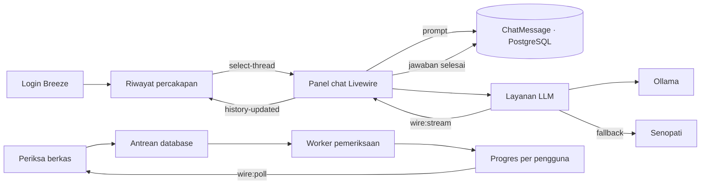
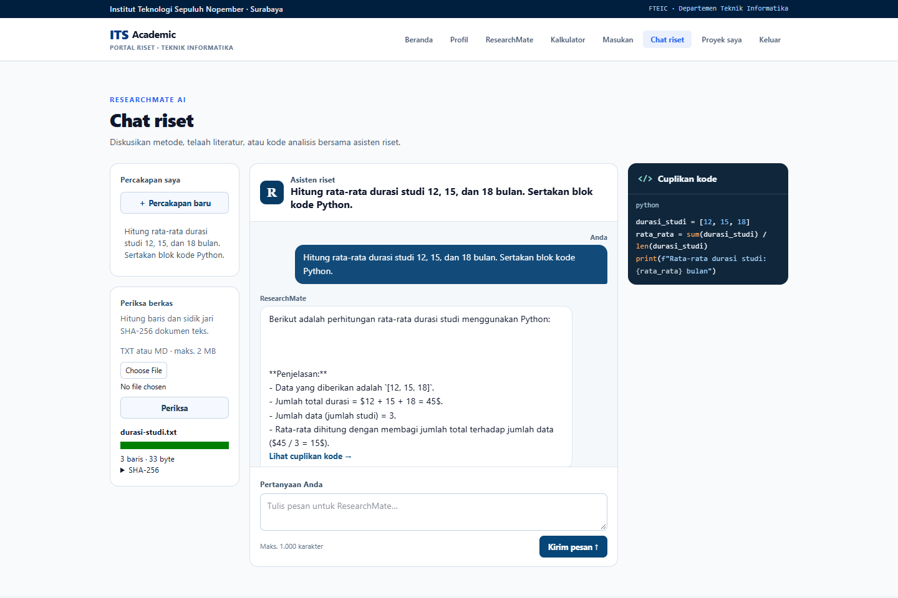
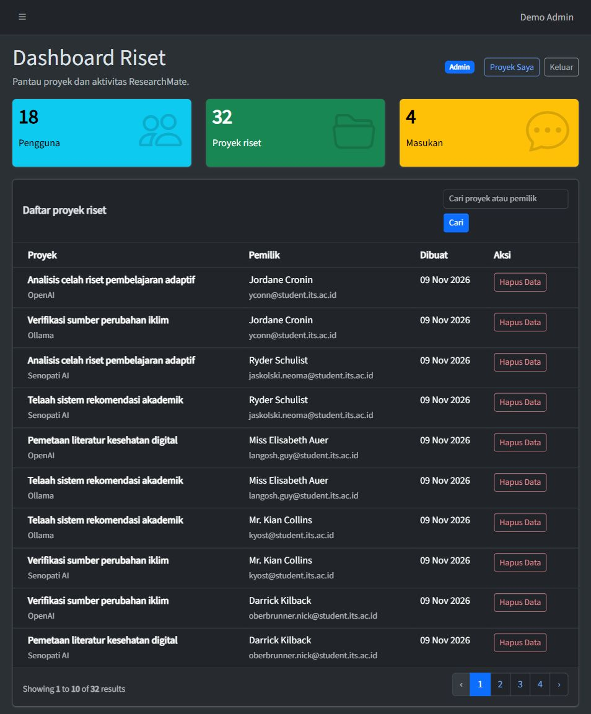

# ITS Academic · ResearchMate AI

ITS Academic memuat profil akademik, kalkulator, masukan pengguna, dan ResearchMate AI untuk merencanakan riset. Pengguna menulis pertanyaan, meninjau kesiapan literatur, lalu menyimpan rencana sebagai proyek pribadi. Panel AdminLTE membantu Admin dan Staf memantau proyek dengan hak akses berbeda. Backend chat ResearchMate memanggil Ollama atau fallback Senopati melalui API yang dilindungi Sanctum dan menyimpan riwayat jawabannya.

## Menjalankan dengan Docker

Aktifkan Docker Desktop, lalu jalankan dari folder project PBKK. Pada salinan baru, buat `.env` dari contoh; pertahankan `.env` yang sudah berisi konfigurasi Anda.

```powershell
if (!(Test-Path .env)) { Copy-Item .env.example .env }
docker compose up -d --build
```

Buka [http://127.0.0.1:8011](http://127.0.0.1:8011). Satu container bernama `pbkk` memuat aplikasi PHP beserta aset frontend yang sudah dibangun, PostgreSQL, dan Ollama. Database dan Ollama berkomunikasi dengan aplikasi melalui localhost di dalam container. Anda tidak perlu menjalankan PHP, Composer, Node.js, PostgreSQL, atau Ollama pada host.

Branch Git menyimpan versi tugas per minggu. Konfigurasi satu container tersedia mulai `w11`. Untuk memakai versi berikutnya yang mewarisi konfigurasi ini, jalankan `docker compose up -d --build` dari branch tersebut. Docker mengganti aplikasi di container `pbkk` dan memakai kembali volume yang sama. Untuk melihat tugas minggu sebelumnya, buka branch minggu tersebut di Git.

Aplikasi menjalankan migrasi saat mulai. Container menyimpan `APP_KEY` dari `.env` pada volume aplikasi. Jika nilainya kosong, aplikasi memakai key di volume atau membuatnya pada instalasi pertama. Saat memakai worktree baru, pakai kembali konfigurasi database dan Senopati dari `.env` lokal. Untuk mengisi database baru dengan akun contoh, jalankan perintah berikut satu kali.

```powershell
docker exec pbkk php artisan db:seed --force
```

Jalankan perintah seed hanya ketika membutuhkan akun contoh; startup biasa tidak mengubah akun atau mengisi ulang data.

Untuk pemakaian berikutnya:

```powershell
docker start pbkk
docker stop pbkk
```

Anda juga dapat memakai tombol Start/Stop untuk container `pbkk` di Docker Desktop. Data PostgreSQL, penyimpanan aplikasi, dan model Ollama tetap ada pada volume Docker saat container berhenti. `docker compose down` dapat digunakan untuk menghapus container sambil mempertahankan volume; nyalakan kembali dengan `docker compose up -d`. Untuk melihat status dan log:

```powershell
docker compose ps
docker logs -f pbkk
```

Isi `SENOPATI_API_KEY` pada `.env` lokal. Compose memasukkannya saat container berjalan; `.env` tidak masuk image maupun Git. Gateway memakai domain `senopati.lab-alpro.com`. Setelah mengubah `.env`, jalankan `docker compose up -d --force-recreate app` agar nilai baru terbaca. Konfigurasi Docker menyertakan sertifikat CA untuk HTTPS.

## Menjalankan tanpa Docker

Alternatif ini membutuhkan PHP 8.3+ dengan ekstensi `pdo_pgsql`, Composer, Node.js, serta PostgreSQL 16 yang berjalan terpisah. Atur `DB_HOST`, `DB_PORT`, `DB_DATABASE`, `DB_USERNAME`, dan `DB_PASSWORD` pada `.env` sesuai PostgreSQL tersebut.

```powershell
composer install
if (!(Test-Path .env)) { Copy-Item .env.example .env }
php artisan key:generate
php artisan migrate --seed
npm ci
php artisan adminlte:install --only=assets --only=vendor_assets --only=translations
npm run build
php artisan serve --host=127.0.0.1 --port=8011
```

Di komputer pengembangan ini, `. .\dev-env.ps1` mengaktifkan runtime PHP dan ekstensi PostgreSQL. Buka `/admin/dashboard` setelah masuk sebagai Admin atau Staf.

| Akun uji lokal | Email | Kata sandi | Akses |
| --- | --- | --- | --- |
| Admin | `admin@researchmate.local` | `demo12345` | Lihat semua proyek dan hapus data |
| Staf | `staf@researchmate.local` | `demo12345` | Lihat dan cari proyek, tanpa hapus |
| Peneliti | `dosenpbkk@its.ac.id` | `demo12345` | Proyek pribadi |

Pada lingkungan `local` di `127.0.0.1`, halaman login menyediakan tombol masuk instan Admin dan Staf. Container Docker lokal mengaktifkannya melalui `LOCAL_DEMO_LOGIN=true` dan hanya membuka aplikasi pada loopback host. Seeder hanya membuat akun dan proyek contoh pada lingkungan `local`; pada lingkungan lain ia hanya menyiapkan role dan permission. Untuk memberi peran pada akun nyata setelah registrasi, jalankan `php artisan tinker` lalu `\App\Models\User::where('email', 'alamat@domain')->firstOrFail()->assignRole('Admin');` (atau `Staf`).

## Chat API

Pada Docker, Ollama berjalan dengan CPU di dalam container `pbkk`, dan `OLLAMA_MODEL=qwen3.5:2b` direkomendasikan untuk pengembangan lokal. Model disimpan di volume agar tidak diunduh ulang setiap container dimulai. Aplikasi tetap dapat berjalan selama unduhan pertama berlangsung; Senopati menjadi fallback bila sudah dikonfigurasi. Untuk melihat model yang tersedia:

```powershell
docker exec pbkk ollama list
```

Untuk cara tanpa Docker, jalankan Ollama pada host dengan model yang sesuai kemampuan mesin, lalu atur `OLLAMA_MODEL` pada `.env`:

```powershell
ollama pull qwen3.5:2b
ollama serve
```

`OLLAMA_URL` berisi URL dasar Ollama, yaitu `http://127.0.0.1:11434` pada Docker maupun contoh instalasi host. Aplikasi memakai `/api/chat`. Gateway Senopati PBKK menggunakan `SENOPATI_URL=https://senopati.lab-alpro.com/llm-gateway/v1`, dengan `SENOPATI_API_KEY` yang sama dan `SENOPATI_MODEL` sesuai akses Anda. Aplikasi menambahkan `/chat/completions` secara otomatis; konfigurasi URL lengkap tetap didukung. `LLM_TIMEOUT` membatasi waktu tunggu dan `LLM_MAX_TOKENS` membatasi panjang keluaran. Pada instalasi tanpa Docker, jalankan `php artisan config:clear` dan mulai ulang proses server setelah mengubah `.env`.

Login melalui `POST /api/login`, lalu kirim token Bearer ke `POST /api/chat-ai` atau `POST /api/chat-ai/stream`. Token berlaku satu jam dan dapat dicabut melalui `DELETE /api/token`. Prompt wajib berupa string maksimal 1000 karakter. System prompt mengarahkan jawaban pada riset akademik ResearchMate tanpa mengarang sumber. Riwayat menyimpan pengguna, prompt, jawaban, model, provider, dan penggunaan token. Jumlah token bernilai `null` jika provider tidak mengirim statistik.

Kontrak lengkap, contoh request/response, SSE, serta kode error ada di [dokumentasi API](docs/api.md). Impor [koleksi Postman](docs/postman/researchmate-w11.postman_collection.json) untuk demo login, penolakan tanpa token, chat, streaming, dan pencabutan token. Pengguna portal juga dapat membuka **Chat riset** setelah masuk.

## Workspace Chat riset

Buka [Chat riset](http://127.0.0.1:8011/chat) dan masuk dengan akun portal. Pilih **Percakapan baru**, tulis pertanyaan, lalu pilih **Kirim pesan**. Jawaban mengalir ke balon chat. Riwayat di sebelah kiri membuka kembali percakapan milik akun aktif. Jika koneksi AI terputus, **Lanjutkan jawaban** memakai pertanyaan yang sudah tersimpan.

Pada branch `w13`, tabel `chat_conversations` mengikat percakapan ke pengguna. Model `ChatMessage` menyimpan setiap giliran pengguna dan asisten di PostgreSQL sesuai konfigurasi PBKK. Frontend memakai sesi Breeze dan memanggil layanan LLM yang sama dengan API Sanctum. Layanan membawa hingga 12 pesan terdahulu dari percakapan aktif. Panel kanan menyorot blok kode dari jawaban terakhir yang memuat kode.



Pada **Periksa berkas**, unggah TXT atau MD hingga 2 MB. Worker di dalam container membaca berkas privat, menghitung jumlah baris dan SHA-256, lalu menghapus salinan kerja. Hasil pemeriksaan tersedia selama satu jam. Untuk instalasi tanpa Docker, jalankan `php artisan queue:work database` di terminal kedua.



Untuk demo lima menit, masuk dan kirim pertanyaan yang meminta contoh kode Python. Tunjukkan balon jawaban dan panel kode, muat ulang untuk membuka riwayat, lalu periksa satu berkas TXT. Masuk dengan akun kedua untuk menunjukkan pemisahan percakapan.

## Fitur

- Registrasi, login, dan dashboard yang hanya menampilkan proyek milik akun aktif, terbaru lebih dulu.
- Alur rencana riset sampai penyimpanan proyek; draf disimpan dalam sesi ketika pengguna perlu masuk atau mendaftar. Rencana tersimpan dapat dibuka dari dashboard, dan pengguna dapat memulai rencana baru tanpa membawa draf sebelumnya.
- Relasi `users`–`projects`, email unik, penghapusan berantai, proteksi mass assignment, dan cast terenkripsi untuk API key.
- Formulir rencana riset dengan validasi, hasil berbasis input, dan penjelasan bukti angka. Pertanyaan serta jumlah sumber disimpan bersama proyek.
- Formulir masukan dengan validasi server, perlindungan CSRF, pemulihan input lama, dan tantangan matematika berbasis sesi.
- Halaman profil mahasiswa, konsep ResearchMate, kalkulator, dan IPK.
- Panel AdminLTE dengan autentikasi bergaya Laravel Breeze, role dan permission Spatie, tiga statistik `count()` dari database, tabel proyek dengan pencarian `when()` dan pagination yang mempertahankan kueri, serta penghapusan khusus Admin pada tampilan dan server.
- Chat API terproteksi Sanctum, FormRequest, API Resource, riwayat database, streaming SSE nyata, system prompt ResearchMate, dan fallback otomatis sebelum keluaran pertama.

Seeder lokal menyediakan 15 akun mahasiswa dengan dua proyek riset per akun serta akun demo. `.env`, `vendor/`, dan `node_modules/` diabaikan Git.



## Verifikasi

```powershell
php tests/database_check.php
python tests/check.py --week 10 --php C:\path\to\php.exe
python tests/api_check.py --php C:\path\to\php.exe
```

Uji browser workspace memakai database SQLite sementara dan provider lokal. Setelah memasang Playwright untuk Python (`python -m pip install playwright`, `python -m playwright install chromium`) dan membangun aset, jalankan `python tests/workspace_check.py --php C:\path\to\php.exe`. Pengujian mencakup akses dua akun, konteks percakapan, pemulihan jawaban, panel kode, antrean berkas, serta lebar layar ponsel.

Pemeriksaan API membuat database SQLite sementara dan provider HTTP pengujian yang terisolasi. Ia memeriksa autentikasi, validasi, pencatatan jawaban, SSE, fallback, dan kegagalan tanpa memakai kuota Senopati. Pengujian provider palsu tidak menggantikan verifikasi koneksi ke Ollama atau Senopati pada lingkungan Anda. Konfigurasi aplikasi tetap menggunakan PostgreSQL secara bawaan.

Chat JSON dan SSE juga telah diuji langsung dengan PostgreSQL 16 dan Ollama `qwen3.5:2b`. Pada komputer ini model tersebut sudah terpasang; set `OLLAMA_MODEL=qwen3.5:2b` untuk menggunakannya. Pada 19 November 2026, koneksi Senopati terautentikasi ke domain `senopati.lab-alpro.com` berhasil diuji memakai `qwen3:14b`, termasuk fallback JSON dan streaming SSE. Key lokal tidak disertakan di Git.

Lihat [batas fitur saat ini](docs/researchmate.md) untuk perbedaan antara konsep platform ResearchMate dan fitur yang sudah dapat dijalankan di aplikasi ini.
